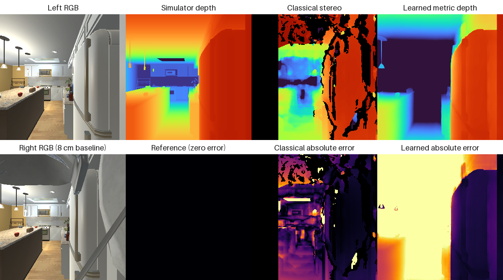
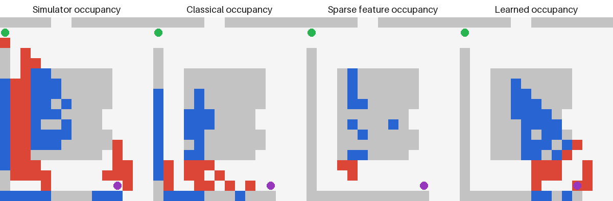
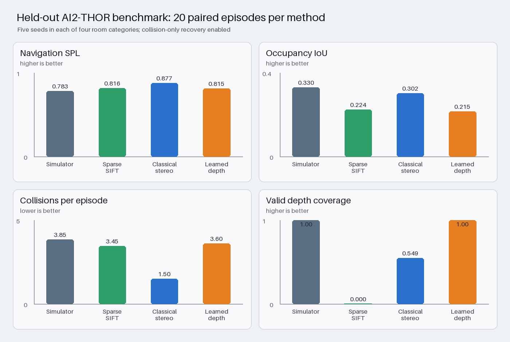
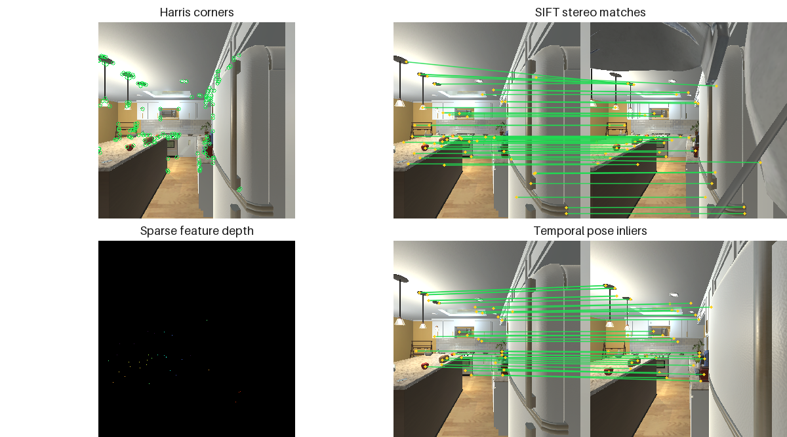
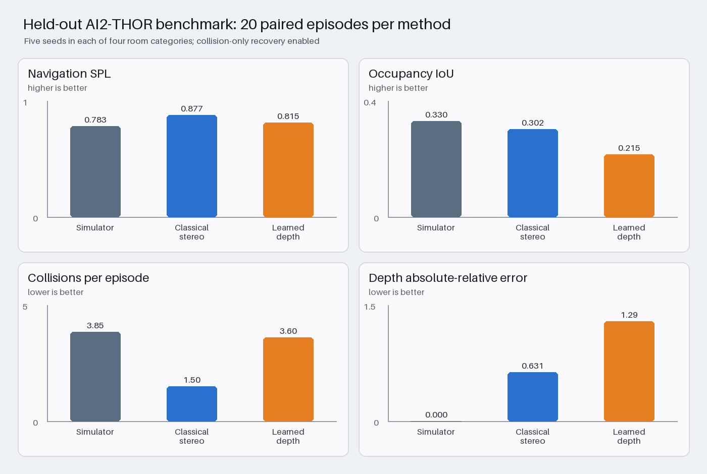

# Experiment protocol and current baseline

## Question

How do classical stereo and pretrained learned metric depth affect mapping and
closed-loop navigation when the planner, action space, scenes, starts, and goals
are held fixed?

## Methods

- `simulator_depth`: AI2-THOR metric depth. This is a perception upper-bound,
  not a deployable comparison method.
- `classical_stereo`: two horizontally separated RGB views, OpenCV SGBM,
  calibrated focal length and 8 cm baseline.
- `classical_sparse_features`: SIFT descriptors with Lowe-ratio filtering,
  rectified epipolar filtering, fundamental-matrix RANSAC, and sparse metric
  triangulation. Harris corners are reported as an additional classical feature
  diagnostic.
- `learned_metric_depth`: Depth Anything V2 Small, pretrained for indoor metric
  depth. No AI2-THOR frames or ground truth were used for training or tuning.

Every method projects depth rays onto the same 25 cm occupancy grid and uses the
same A* controller. Repeated visual observations produce soft occupancy evidence;
collisions produce permanent hard obstacles. If visual noise disconnects the
map, the safety recovery planner temporarily ignores soft obstacles but retains
all collision obstacles.

## Metrics

- Success: goal reached before the action budget.
- Collisions: failed `MoveAhead` actions.
- Path length: attempted translation actions.
- SPL: success weighted by shortest-path efficiency.
- Occupancy IoU: intersection over union with the reachability-derived reference.
- Symmetric Chamfer distance: mean grid-cell distance between predicted and
  reference occupied sets; lower is better.
- Depth AbsRel: mean absolute relative depth error on valid pixels; lower is
  better.
- Depth RMSE: root mean squared metric-depth error in meters; lower is better.
- Coverage: fraction of reference-depth pixels for which the method produced a
  valid estimate; higher is better.

## Current FloorPlan1 result

Five paired, fixed seeds were run for every method with full height-filtered
point-cloud projection. Each row uses the same starts, goals, A* controller, and
collision recovery policy.

| Method | Success | Collisions | Path | SPL | IoU | Chamfer | AbsRel | RMSE (m) | Coverage |
|---|---:|---:|---:|---:|---:|---:|---:|---:|---:|
| Simulator depth | 100% | 3.4 | 38.4 | 0.804 | 0.398 | 0.802 | 0.000 | 0.000 | 1.000 |
| Classical stereo | 100% | 4.0 | 32.2 | 0.754 | 0.516 | 0.621 | 0.546 | 2.918 | 0.540 |
| Learned metric depth | 100% | 3.4 | 27.2 | 0.882 | 0.372 | 0.961 | 1.280 | 3.303 | 1.000 |

The point-cloud mapper raises occupancy IoU far above the earlier scanline range
of 0.018--0.077. Classical stereo is substantially more accurate than the
learned model on valid pixels, but only covers about 54% of the image.
The learned model produces dense depth and obtains the best navigation SPL even
though its metric-depth error is worse. This is not contradictory: the A*
controller needs useful obstacle boundaries, not perfect per-pixel reconstruction,
and collision recovery can correct perception failures online.

These results validate the system but are not yet a final scientific conclusion.
Five episodes in one kitchen are too few for inference. The simulator-depth row
is an upper-bound sensor rather than a competing method, and recovery makes goal
success less sensitive than the mapping and depth metrics.

## Qualitative diagnostics

The saved figure compares the RGB stereo pair, ground-truth depth, both inferred
depth maps, and their absolute-error maps:

Blue occupancy cells are true positives, red cells are false positives, gray
cells are reference obstacles not observed from this pose, green is the start,
and purple is the goal:

AI2-THOR RGB frames are converted with RGB channel ordering. Stereo disparity
first gives axial z-depth, which is converted to Euclidean camera-ray distance
before comparison and projection. This matches both AI2-THOR's depth-frame
definition and the Hypersim distance target used to train the indoor learned
model.

## Held-out cross-category result

Five paired seeds were run in a held-out kitchen (`FloorPlan2`), living room
(`FloorPlan202`), bedroom (`FloorPlan302`), and bathroom (`FloorPlan402`), for
20 episodes per method and 60 total episodes.

| Method | Success | Collisions | Path | SPL | IoU | Chamfer | AbsRel | RMSE (m) | Coverage |
|---|---:|---:|---:|---:|---:|---:|---:|---:|---:|
| Simulator depth | 100% | 3.85 | 27.60 | 0.783 | 0.330 | 1.202 | 0.000 | 0.000 | 1.000 |
| Sparse SIFT/RANSAC | 100% | 3.45 | 22.10 | 0.816 | 0.224 | 1.252 | 0.409 | 5.935 | 0.00039 |
| Classical stereo | 100% | 1.50 | 18.35 | 0.877 | 0.302 | 1.283 | 0.631 | 2.060 | 0.549 |
| Learned metric depth | 100% | 3.60 | 20.05 | 0.815 | 0.215 | 1.441 | 1.289 | 1.994 | 1.000 |

All methods reached every goal. Against classical stereo, learned depth had 2.1
more collisions per episode (paired bootstrap 95% CI 1.15 to 3.10), 0.062 lower
SPL (CI from -0.106 to -0.021), and 0.087 lower occupancy IoU (CI from
-0.159 to -0.018). Learned depth covered the full image while stereo covered
54.9%.
Learned depth's AbsRel was 0.658 higher (CI 0.504 to 0.808), although the RMSE
difference was inconclusive (learned minus stereo -0.066 m, CI -0.292 to 0.151).

The exact category breakdown shows that the aggregate ranking is not universal:
learned depth had higher occupancy IoU in `FloorPlan2`, while classical stereo
led in the other three categories. This is why scenes and starts are paired and
the by-scene CSV is retained.

Simulator depth is a raw-sensor upper bound, not a guaranteed navigation upper
bound. Its dense geometry can make the shared height-filter/grid mapper more
conservative; sparse stereo can implicitly filter obstacles and therefore take
shorter routes. That interaction is itself an experimental result and should be
reported rather than hidden.

Sparse SIFT depth must be interpreted with its coverage: only 0.039% of pixels
receive valid triangulated depth. Its low AbsRel is conditional on that tiny,
feature-rich subset, while its 5.94 m RMSE exposes severe outliers. Its high
navigation success is largely possible because unknown grid cells remain
traversable and collisions add hard obstacles. Dense SGBM is therefore the main
classical navigation method; sparse SIFT/RANSAC is retained as a direct
course-algorithm baseline and geometry diagnostic.

## Feature geometry and visual odometry

The classical feature pipeline now explicitly implements the algorithms named
in the proposal:

1. Harris corner response with non-maximum suppression.
2. SIFT detection and description.
3. Lowe-ratio descriptor filtering.
4. Fundamental-matrix RANSAC for stereo consistency.
5. Essential-matrix RANSAC and `recoverPose` across consecutive frames.
6. Sparse stereo triangulation using calibrated focal length and baseline.

A representative kitchen view produced 150 Harris corners, 52 SIFT stereo ratio
matches, 35 stereo RANSAC inliers, 47 temporal SIFT matches, and 34 temporal pose
inliers.

The temporal visual-odometry benchmark uses controlled 25 cm forward motions and
compares recovered motion against simulator pose only for evaluation.

| Scene | Pose recovery | Mean matches | Inlier ratio | Translation direction error | Rotation error |
|---|---:|---:|---:|---:|---:|
| Kitchen (`FloorPlan2`) | 100% | 66.7 | 0.786 | 9.47° | 1.35° |
| Living room (`FloorPlan202`) | 100% | 58.1 | 0.810 | 10.98° | 0.92° |
| Bedroom (`FloorPlan302`) | 90% | 20.7 | 0.694 | 35.20° | 3.73° |
| Bathroom (`FloorPlan402`) | 70% | 9.3 | 0.600 | 54.46° | 30.58° |
| **Aggregate** | **90%** | **38.7** | **0.722** | **25.07°** | **7.51°** |

The texture-rich kitchen and living room support reliable motion estimation;
the bathroom is a clear failure case because it produces few repeatable
features. Navigation currently uses simulator pose to isolate depth/mapping
quality, while visual odometry is evaluated separately. Closing the mapping loop
with estimated pose is the remaining high-risk CV integration step.

## Recovery-policy ablation

The same 20 paired scene/seed cases were run with `--disable-recovery`.

| Method | Success without | Success with | SPL without | SPL with | IoU without | IoU with |
|---|---:|---:|---:|---:|---:|---:|
| Simulator depth | 15% | 100% | 0.134 | 0.783 | 0.262 | 0.330 |
| Classical stereo | 95% | 100% | 0.863 | 0.877 | 0.295 | 0.302 |
| Learned metric depth | 95% | 100% | 0.789 | 0.815 | 0.209 | 0.215 |

For simulator depth, enabling recovery increased success by 0.85 (paired
bootstrap 95% CI 0.70 to 1.00) and SPL by 0.649 (CI 0.485 to 0.795). For the two
learned-sensor methods, the SPL intervals include zero or touch zero, so this
sample does not establish a recovery benefit of comparable size.

This counterintuitive result is evidence that perfect raw depth does not imply a
perfect 2D navigation map. Dense geometry is more likely to close narrow grid
corridors after height thresholding and quantization; the fallback retains hard
collision obstacles but temporarily ignores uncertain visual obstacles. Failed
no-recovery episodes also stop early, so their lower collision and path counts
must not be interpreted as safer or more efficient navigation.

Current artifacts:

- `results/pointcloud_cross_category_20_calibrated.png`
- `results/pointcloud_cross_category_20_calibrated.json`
- `results/pointcloud_cross_category_20_calibrated.by_scene.csv`
- `results/pointcloud_cross_category_20_calibrated.paired_ci.csv`
- `results/pointcloud_cross_category_20_no_recovery_calibrated.json`
- `results/cross_category_20_recovery_ablation.summary.csv`
- `results/cross_category_20_recovery_ablation.summary.recovery_ci.csv`
- `results/classical_sparse_features_cross_category_20.json`
- `results/cv_methods_cross_category_20.summary.csv`
- `results/cv_methods_cross_category_20.summary.paired_ci.csv`
- `results/vo_cross_category_summary.json`
- `results/vo_cross_category_summary.by_scene.csv`

## Required next experiment

The calibrated height-filtered point-cloud projection, cross-category paired
run, full recovery ablation, and bootstrap confidence intervals are implemented.
Closing the occupancy-mapping loop with estimated visual-odometry pose is the
highest-priority remaining CV extension. A larger multi-scene sample, confidence
intervals clustered by scene, and a second learned architecture are useful after
that if time and GPU access permit.

## Method provenance

The simulator documents `event.frame` as RGB and `depth_frame` as metric distance
to each pixel in its [environment-state reference](https://ai2thor.allenai.org/ithor/documentation/environment-state/).
The learned adapter uses the
[Depth Anything V2 indoor metric checkpoint](https://huggingface.co/depth-anything/Depth-Anything-V2-Metric-Indoor-Small-hf),
which is fine-tuned on Hypersim. Hypersim documents its depth target as Euclidean
distance to the camera optical center in its
[official repository](https://github.com/apple-aiml-research/ml-hypersim).

